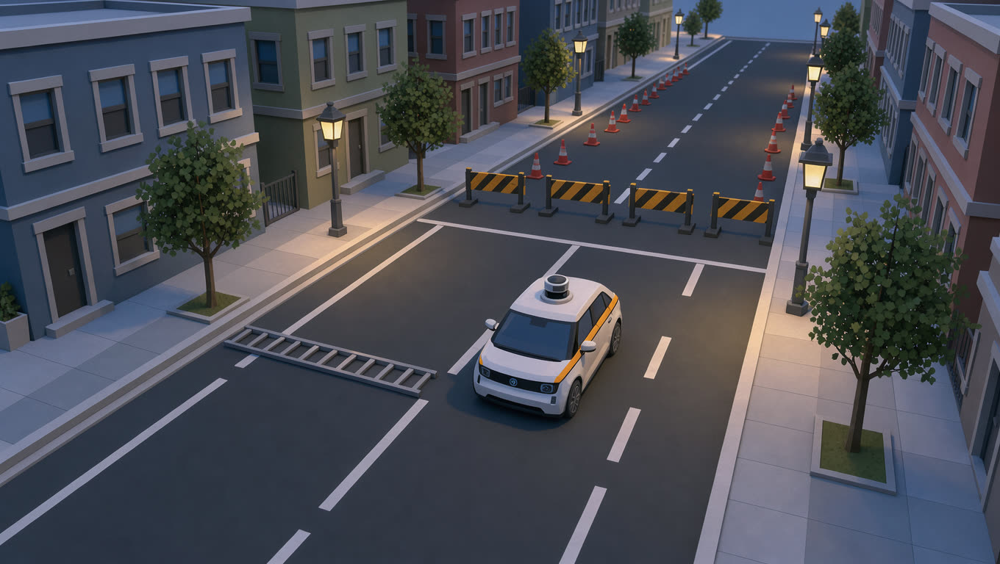
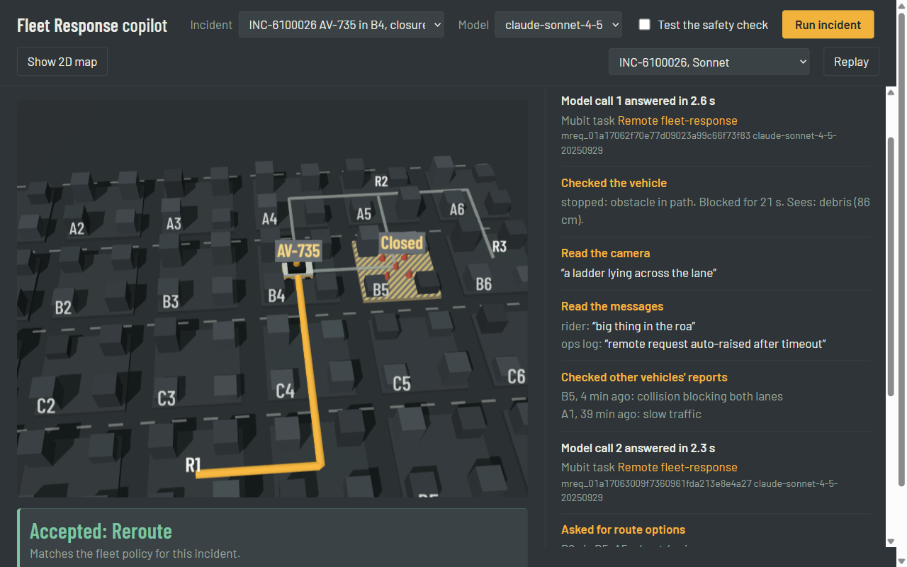

# Fleet Response copilot

**An AI first responder for stuck autonomous vehicles. Advice, not control. Every step distilled by Mubit into the fleet's own model.**

Built at Mubit Night Shift (London, 24-25 Oct 2026).



## The problem

Robotaxis and delivery robots get stuck several times a day: a double-parked van, roadworks, a police officer waving traffic
through, debris, a frightened rider. Today a remote human resolves each one. Waymo calls its operation
[fleet response](https://www.waymo.com/blog/2024/05/fleet-response): the car asks for context, the human suggests a lane or a
path, and **the car stays in control** ([advice, not control](https://waymo.com/blog/shorts/advice-not-control-the-role-of-remote-assistance/)).
It was reported to run with roughly 70 remote agents on duty for about 3,000 vehicles
([TechCrunch](https://www.techcrunch.com/2026/02/22/techcrunch-mobility-waymo-makes-its-defense/)). That human-per-vehicle ratio is
one of the unit economics of autonomy: every request a first-line AI handles correctly is one a person doesn't have to.

## What it does

When a vehicle raises a help request, an AI agent investigates and advises. Code then decides whether the advice is safe.

1. **Triage** (Mubit task 1). The request is classified into one of ten incident types from messy evidence: perception objects,
   a camera caption, and free text from riders, staff, police and the ops log (typos, slang and irrelevant chatter included).
2. **Investigate and advise** (Mubit task 2, tool use). The agent starts with only an alert and calls tools:
   `get_vehicle_state`, `get_camera_caption`, `get_messages`, `get_recent_events` (what *other* vehicles reported nearby: the
   fleet's shared memory) and `get_route_options`. It then calls `submit_advice` with one action: `wait`, `reroute`,
   `mark_zone_closed`, `proceed_with_caution`, `request_human` or `dispatch_event_response`.
3. **Code owns safety.** A validator rejects advice that routes through a zone another vehicle has reported closed, moves a
   vehicle whose perception is degraded, waits for an unbounded time, or names a route that doesn't exist. Rejected advice
   goes to a human. The model never controls the vehicle, so swapping in a smaller model can't make the fleet unsafe.
4. **Fleet policy lives in code, not the prompt's judgement.** The model identifies what is happening. Urgency, whether a human is
   needed and the correct action come from one policy table (`fleet/scenarios.py: POLICY`).

## How it uses Mubit

Every model call goes through Mubit (`fleet/mubit.py`, Anthropic SDK with `base_url=https://api.mubit.ai/anthropic`).

| Mubit feature | How this project uses it |
|---|---|
| **Tasks** | Two frozen system prompts give two clean tasks in the console: *First-line triage* and *Remote fleet-response*. Mubit keys a task on model + instructions + tools + output format, so everything that varies goes in the user message. |
| **Adapters ("a model for every task")** | Each task trains its own small model once 25 examples are kept. Triage is easy for every model we tried (Sonnet and Haiku both 97%), while the tool-using responder is where small and large models differ. That is exactly where a dedicated, cheaper model pays off. |
| **Automatic rollout** | A passing adapter is served by the gateway itself: silent test, then partial rollout, then live. No code change. Every call logs the model that answered it, so the switch shows up in our logs. |
| **Sessions** | `metadata.user_id` = incident ID. One incident's calls stay together, and Mubit sets test cases aside by session, so an incident never leaks between training and testing. |
| **Request IDs** | Every call records Mubit's `x-middleware-request-id`. The scoreboard lists the request IDs of wrong answers, so they can be found in Requests and rated **Bad**, a verified-outcome signal back to Mubit. |
| **Data controls** | When a rider asks for help, their words can be about their health or safety. Those calls send `x-middleware-record: metadata`, so Mubit keeps the call's metadata but never the rider's text, and never trains on it. Measurement runs use the same header, so comparisons never become training data. |
| **Embeddings** (verified) | OpenAI embeddings also route through Mubit (`/openai/v1/embeddings`), if semantic search over past incidents is added. |

## Results so far

Measured through Mubit on 40 generated incidents, identical for both models (`python -m fleet.scoreboard`):

| | claude-sonnet-4-5 | claude-haiku-4-5 |
|---|---|---|
| Correct advice | **90%** | **72%** |
| Unsafe advice blocked by code | 0 | **1** |
| Escalated to a human | 40% | 42% |
| Latency p50 / p90 | 9.5 s / 12.3 s | 5.3 s / 6.8 s |
| Calls per incident | 2.4 | 2.2 |
| Tokens per incident (in / out) | 3,610 / 419 | 3,296 / 437 |
| Est. $ per 1,000 incidents | $17.11 | $5.48 |

Full table with the per-incident-type breakdown: [`results/scoreboard.md`](results/scoreboard.md).

What this shows:
- The large model is more accurate but takes about twice as long and costs about three times as much. A stuck vehicle is
  waiting the whole time. The gap is what a distilled adapter is meant to close: large-model quality at small-model speed and cost.
- Even the large model is wrong 10% of the time, which is why the validator and the human escalation exist.
- **Mubit trained the fleet's first model.** From our traffic (140 triage calls, 100 responder incidents of about 250
  tool-use calls, plus later rollout traffic), Mubit trained a Qwen3-4B-Instruct-2507 adapter per task:

  | Task | Adapter v1 quality | Target | Result |
  |---|---|---|---|
  | First-line triage | **93.8%** | 85% | **Passed its tests**, moving through Mubit's silent test and rollout |
  | Remote fleet-response (multi-turn tool use) | **0%** on 19 test cases | 52.9% | Below target, so Sonnet keeps answering |

  Quality is the share of test cases the adapter answered like the provider model (Mubit console, Sun 25 Oct 06:24 GMT).
  This is the behaviour Mubit promises: the cheap model takes over the task it can do, and the hard agentic task stays on
  the frontier model. A control run of Mubit's own documented example task passed at 100% in the same project.
  (Review was delayed for a few hours by a Mubit outage, which Mubit support confirmed.)

Costs use list prices (Haiku 4.5 $1/$5 per million tokens; Sonnet 4.5 assumed $3/$15) and are estimates.

## How the incidents are generated, and why the answers are known

Real fleets' exception logs are private, so `fleet/scenarios.py` injects a hidden cause into each incident (the same idea as
chaos engineering, or the τ-bench agent benchmark). The model sees only the messy surface: vague captions, contradictory rider
messages, red herrings. Because we injected the cause, every incident has a known correct answer, so nothing here is graded by
another model. `fleet/world.py` adds the city around each incident: route options, and reports from other vehicles. In about 80% of
reroute incidents, the fastest route passes through a zone another vehicle closed minutes earlier.

## What the demo shows

The 2-minute video follows one real recorded incident, `INC-6100026`, through Mubit:



1. **The problem.** Robotaxis get stuck; Waymo was reported to run about 70 remote agents for about 3,000 vehicles.
2. **A help request.** Vehicle AV-735 in zone B4 has stopped: a ladder is lying across the lane.
3. **Triage (Mubit task 1).** One call classifies it as large debris.
4. **The agent investigates (Mubit task 2).** It checks the vehicle, reads the camera and the rider's message ("big thing in the
   roa"), and checks other vehicles' reports: one reported a collision blocking both lanes in B5, four minutes earlier. B5 is on
   the fastest route.
5. **The advice.** The agent reroutes via R1, around B5. Code checks the advice and accepts it.
6. **The safety check, tested on purpose.** With "Test the safety check" on, the agent's advice is replaced with the fastest
   route, R2, straight through closed B5. Code rejects it and escalates to a human. The screen says what the model itself advised,
   so the test is never mistaken for a model error.
7. **How it uses Mubit**, and **the scoreboard**: large model against small, on correctness, speed and cost.

Every step on screen names the Mubit task that served it, with its Mubit request ID.

## Run it

```bash
python -m venv .venv && .venv/Scripts/pip install -r requirements.txt   # or: uv venv && uv pip install -r requirements.txt
cp .env.example .env        # add your Mubit key (mbt_...)

python -m fleet.run_triage --count 10 --pilot              # triage; --pilot = never kept for training
python -m fleet.run_responder --count 10 --pilot           # the agent, validated
python -m fleet.scoreboard --count 40 --seed 61            # large vs small model → results/scoreboard.md
```

Drop `--pilot` to send real traffic that Mubit can train on.

### The demo view

```bash
python -m fleet.demo          # then open http://localhost:8765
```

- Pick an incident and a model, then **Run incident**: triage and the responder run live through Mubit, and each step streams in.
- **Test the safety check** swaps the agent's advice for the fastest route, to show the validator rejecting it.
- **Show 2D map / Show 3D city** switches views. If WebGL or the Three.js CDN is unavailable, the page falls back to 2D by itself.
- Every live run is saved to `results/demo/` and can be **replayed** at its original pace without network access.
  `results/demo/mubit_status.json` holds the adapter status shown in the footer, copied from the Mubit console with its time
  (Mubit has no read API for task status).

## Docs

- [`docs/architecture.md`](docs/architecture.md): components, the per-incident sequence, the Mubit layer, safety guarantees and their limits.
- [`docs/pitch-deck.pdf`](docs/pitch-deck.pdf): the 10-slide deck.
- [`docs/design-system.md`](docs/design-system.md): the colours, type and shapes shared by the demo, the deck and the diagram.

## Layout

```
fleet/
  mubit.py         one Anthropic client pointed at Mubit; request IDs, served model, data-control headers
  scenarios.py     incident generator with injected causes; the fleet POLICY table
  world.py         per-incident city: route options, other vehicles' reports, closed zones
  triage.py        task 1: frozen prompt + grader
  responder.py     task 2: tool-using agent + safety validator
  run_triage.py    run/grade/log triage
  run_responder.py run/grade/log the agent
  scoreboard.py    same incidents on several models → results/
  demo.py          demo server: streams each step (server-sent events), records and replays runs
  web/index.html   the demo view: Three.js city with a 2D fallback, the agent's log, the Mubit strip
  web/assets/      robotaxi.glb
results/           curated results and recorded demo runs (raw logs in runs/ are not committed)
docs/              architecture, deck, design system
```

The robotaxi model was generated for this project with Runware (an image generated with FLUX, then converted to 3D with Meshy-6). The cover image was also generated with Runware (FLUX).

## Limits, stated plainly

- The incidents are generated, not real fleet data. The claim is about the shape of the workload and the safety architecture.
- The triage adapter passed its tests but was not yet serving live calls at submission: Mubit's rollout needs graded
  silent-test pairs and a partial rollout first. The responder adapter (multi-turn tool use) is below target.
- The cost figures are estimates from list prices, not invoices.
- The rejected route in the demo comes from the deliberate "Test the safety check" control. In the 40-incident scoreboard, the
  validator caught one unsafe answer from Haiku on its own (an out-of-range wait time).
