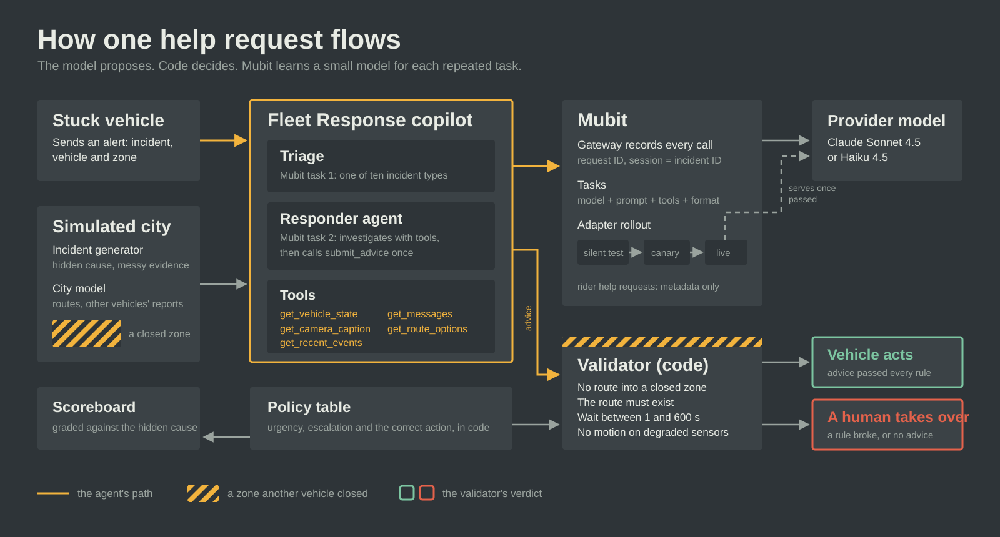
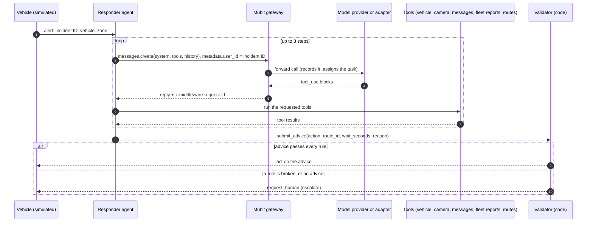
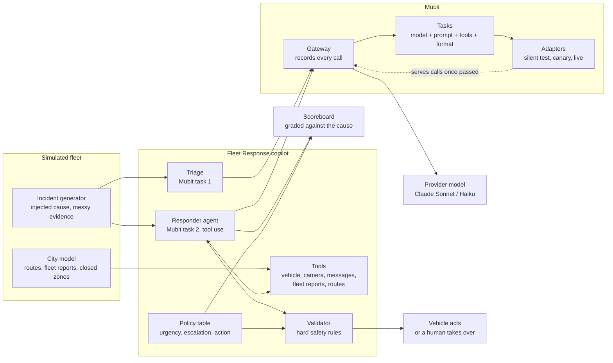

# Architecture

Fleet Response copilot is a first responder for autonomous vehicles that get stuck. A vehicle asks for help, an AI agent
investigates and proposes one action, and deterministic code decides whether the vehicle may act on it. Every model call goes
through Mubit, which records the calls, groups them into tasks and trains a small model for each task.

## Design principles

1. **Advice, not control.** The agent never moves a vehicle. It submits advice; code validates it. This mirrors Waymo's
   published model of remote assistance ([fleet response](https://www.waymo.com/blog/2024/05/fleet-response),
   [advice, not control](https://waymo.com/blog/shorts/advice-not-control-the-role-of-remote-assistance/)).
2. **Policy in code, perception in the model.** The model's job is to work out what is happening from messy evidence. What
   the fleet should do about it (urgency, whether a human is needed, the correct action) lives in one policy table.
3. **Frozen prompts, varying data.** Mubit keys a task on model + instructions + tools + output format. Each task has one
   frozen system prompt and tool list; everything that changes per incident goes in the user message or tool results.
4. **Known answers.** Every incident is generated from an injected cause, so every answer can be graded by code, not by
   another model.

## Components

| Component | File | Responsibility |
|---|---|---|
| Incident generator | `fleet/scenarios.py` | Builds a help request from a hidden cause: perception objects, a camera caption, free-text messages (typos, slang, red herrings), planner status, time blocked. Holds the fleet `POLICY` table. |
| City model | `fleet/world.py` | Per-incident, seeded from the incident ID: three route options on a 4x6 zone grid, reports from other vehicles, and the set of closed zones. Identical for every model that replays the incident. |
| Triage | `fleet/triage.py` | Mubit task 1. Frozen prompt; returns one of ten categories as JSON. Graded against the injected cause. |
| Responder | `fleet/responder.py` | Mubit task 2. A tool-use loop (up to 8 steps) with five investigation tools and `submit_advice`. |
| Validator | `fleet/responder.py: validate()` | Hard safety rules applied to every piece of advice before a vehicle may act. |
| Mubit client | `fleet/mubit.py` | One Anthropic client with `base_url=https://api.mubit.ai/anthropic`. Records the request ID and the model that served each call, and sets Mubit's data-control headers. |
| Runners | `fleet/run_triage.py`, `fleet/run_responder.py` | Run, grade and log batches of incidents. |
| Scoreboard | `fleet/scoreboard.py` | The same incidents on several models, written to `results/scoreboard.md` and `.json`. |
| Demo view | `fleet/` (demo server and page) | A city grid with the agent's tool calls streaming and the validator's verdict. |

## One incident, end to end

The agent starts with only the alert. It has to call `get_vehicle_state`, `get_camera_caption`, `get_messages`,
`get_recent_events` and `get_route_options` to learn anything, then `submit_advice` exactly once. Measured on 40 incidents,
Sonnet 4.5 averaged 2.4 calls and Haiku 4.5 2.2 calls per incident (tools are often requested in parallel within one step).

## System view

## The Mubit layer

| Concern | How it is handled |
|---|---|
| Routing | `fleet/mubit.py` points the Anthropic SDK at `https://api.mubit.ai/anthropic` with the Mubit key. No other code knows about Mubit. |
| Tasks | Two frozen system prompts produce two tasks in the console: *First-line triage* and *Remote fleet-response*. Changing a prompt would start a new task and reset its example count, so prompts are locked once traffic is flowing. |
| Sessions | `metadata.user_id` is set to the incident ID (on the Anthropic route Mubit reads `user_id` as the session). One incident's steps stay together, and Mubit sets test cases aside by session, so an incident never sits on both sides of the train/test split. |
| Adapters | A task trains its first adapter at 25 kept examples. Under the project settings a version must answer within 5 points of the provider model, and live needs 20 judged test cases. |
| Rollout | Approval is automatic once a version passes: a silent test answers copies of 10% of calls (up to 100 a day), then a partial rollout answers 10% of calls for real (at least 100 calls), then the version goes live. The provider re-answers 2% of live calls as spot checks. No code change is needed; every call logs the model that served it. |
| Request IDs | Every reply carries `x-middleware-request-id`. Runs log them, and the scoreboard lists the IDs of wrong answers so they can be found in Requests and rated Bad. |
| Data controls | A rider asking for help writes about their own health or safety, so those calls send `x-middleware-record: metadata`: Mubit keeps the call's metadata but not its text, and never trains on it. Measurement runs use the same header, so comparisons never become training data. |
| Traffic and results | Training traffic: 152 triage calls and 254 responder calls, answered by Sonnet 4.5; 700 more triage calls followed to drive the rollout (852 in total). Mubit console, Sun 25 Oct 06:43 GMT: the triage adapter v1 (Qwen3-4B) matched Sonnet on 93.8% of held-out tests against an 85% target and passed, not yet live; the responder adapter v1 scored 0% against 52.9%, so Sonnet keeps answering it. |

## Data and ground truth

Real fleets' exception logs are private, so the incidents are generated. Each one starts from a hidden cause (one of ten:
double parked short or abandoned, construction closure, police hand signals, emergency vehicle, small or large debris,
degraded sensors, rider safety, conflicting reports). The model sees only the surface: vague captions, rider messages that may
be wrong, irrelevant chatter, misspellings. Because the cause is known, the correct triage category and the correct action
are known, and grading is a comparison, not a judgement.

The city model adds the shared-memory twist: in about 80% of incidents whose correct action is a reroute, the fastest route
passes through a zone another vehicle closed minutes earlier. Only the fleet's recent reports reveal it.

## Safety guarantees, and their limits

The validator enforces, for every piece of advice:

- the action is one of the six allowed actions;
- a reroute names a route that exists, and that route enters no zone another vehicle has reported closed;
- a wait lasts between 1 and 600 seconds;
- a vehicle whose perception is degraded is never told to move;
- anything that breaks a rule, or no advice at all, becomes `request_human`.

What it does not guarantee: that the advice is the *best* action. A wrong but safe answer (waiting behind an abandoned car)
passes the validator and is counted as incorrect by the scoreboard. The validator protects against unsafe advice; the
scoreboard measures correctness; the human escalation path covers the rest.

Measured on 40 incidents (seed 61): Sonnet 4.5 was correct 90% of the time, Haiku 4.5 72%. The validator blocked one unsafe
suggestion from Haiku and none from Sonnet.

## Failure handling

- **Gateway or transport errors** are recorded as errors, distinct from wrong answers, and the incident escalates to a human.
- **A reply that is not the JSON asked for** raises `BadAnswer` in triage instead of being treated as a category.
- **No `submit_advice` within 8 steps** escalates to a human.
- **Mubit's review queue** can lag: task assignment took several minutes during the event, and both tasks sat in "Reviewing
  examples" for a few hours during a Mubit outage (confirmed by Mubit support). Review then resumed and the triage adapter
  trained and passed. The system works on the provider model throughout; the adapter is an improvement path, not a dependency.
